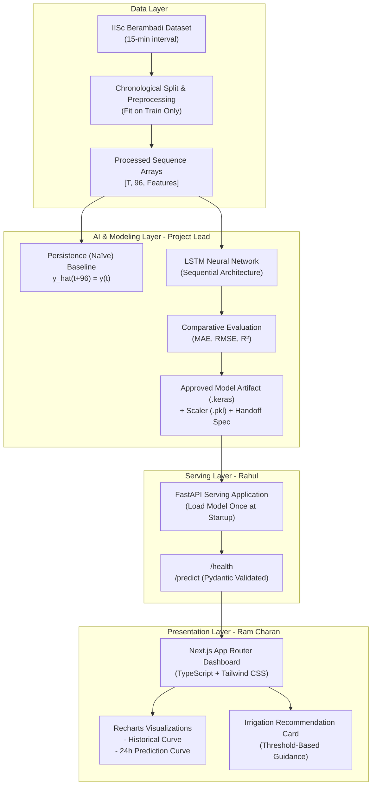

# System Architecture — Smart Irrigation Prediction

## 1. System Overview
The Smart Irrigation Prediction system is designed to provide farmers and agronomists with reliable, 24-hour advance soil moisture predictions (`SM_50cm`) to make data-backed irrigation decisions.

## 2. Core Architectural Principles
1. **Decoupled Architecture:** The ML training pipeline, FastAPI serving backend, and Next.js frontend are strictly decoupled with clear interface boundaries.
2. **Zero In-Request Training:** The backend loads pre-trained model artifacts once at startup; no training occurs inside HTTP request handlers.
3. **Temporal Leakage Prevention:** Data splits and scalers are fitted exclusively on training sets.
4. **Strict Typed Contracts:** Communication between Frontend and Backend is mediated by strongly typed Pydantic models and TypeScript interfaces.
