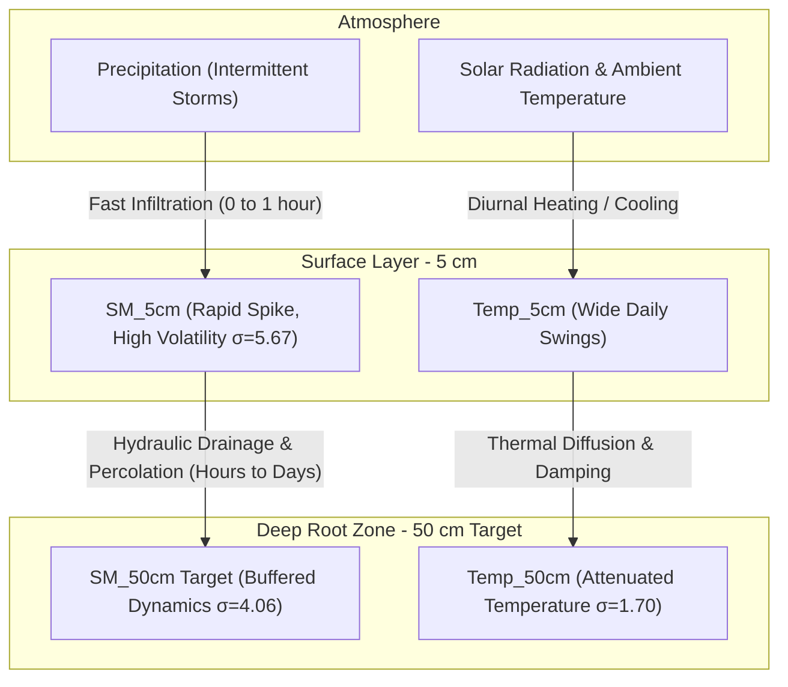

# Phase 1: Exploratory Data Analysis (EDA) & Field Guide

- **Project:** Deep Learning-Based Soil Moisture Prediction for Smart Irrigation  
- **Primary Target Variable:** `SM_50cm` (Soil Moisture at 50 cm depth, Volumetric Water Content in %)  
- **Forecast Horizon:** 24 Hours ahead = 96 Time Steps ($\Delta t = 15 \text{ minutes}$)  
- **Dataset Source:** IISc Berambadi/Bechanahalli Watershed, Karnataka, Southern India ([Zenodo 22109968](https://zenodo.org/records/22109968))  
- **Audited Period:** January 1, 2016 – June 30, 2025 (10 Annual Releases)  
- **Total Observations Audited:** 286,062 timestamps  

---

## 1. Executive Summary of Empirical Findings

1. **Sampling Frequency Verified:**
   - **99.82%** of all consecutive rows across 10 years are separated by **exactly 15 minutes** ($0 \text{ days } 00:15:00$).
   - Mathematically confirms our research formulation: 24-hour forecast horizon = **96 time steps** ($24 \text{ hours} \times 4 \text{ steps/hour}$).
2. **Target Variable Plausibility:**
   - `SM_50cm` spans physically valid bounds from **0.0% to 55.0% Volumetric Water Content (VWC)**. No physically impossible sensor values detected.
3. **Sensor Infrastructure Shift (2021 Transition):**
   - 2016–2020: Electrical Conductivity (EC) sensors.
   - 2022–2025: Modern Relative Dielectric Permittivity (RDP) sensors.
   - 2021 transition year suffered **67.1% missing data** at 50 cm depth during hardware re-instrumentation.
4. **Pristine Modern Benchmark Period (2022–2025):**
   - Modern period contains **119,940 consecutive time steps** with **0.0000% missing data** for `SM_50cm`, `SM_5cm`, `Temp_50cm`, and `Temp_5cm`.
5. **Autocorrelation & Soil Inertia:**
   - Autocorrelation of `SM_50cm` at lag 96 (24 hours ahead) is **0.9141**.
   - Proves why Persistence ($\hat{y}_{t+96} = y_t$) is a strong baseline, and why an LSTM must learn infiltration responses to outperform it.

---

## 2. Annual Data Inventory & Target Variable Profile

All figures below are computed directly from the raw data files in `data/raw/`:

| Year | File | Rows | Start Date | End Date | Columns | SM_50cm Missing % | SM_50cm Mean (%) | SM_50cm Min (%) | SM_50cm Max (%) | Hardware Context |
| :---: | :--- | :---: | :---: | :---: | :---: | :---: | :---: | :---: | :---: | :--- |
| **2016** | `2016_V1.csv` | 35,041 | 2016-01-01 | 2016-12-31 | 8 | **0.0%** | 32.45% | 2.4% | 42.3% | EC probe (swap depth corrected) |
| **2017** | `2017_V1.csv` | 35,027 | 2017-01-01 | 2017-12-31 | 8 | **0.0%** | 17.83% | 0.0% | 44.5% | EC probe (swap depth corrected) |
| **2018** | `2018_V1.csv` | 33,309 | 2018-01-01 | 2018-12-31 | 8 | **23.9%** | 16.85% | 3.2% | 43.4% | Partial sensor logger downtime |
| **2019** | `2019_V1.csv` | 22,620 | 2019-01-01 | 2019-12-31 | 8 | **0.4%** | 15.90% | 0.6% | 44.1% | Partial annual coverage |
| **2020** | `2020_V1.csv` | 7,733 | 2020-10-12 | 2020-12-31 | 8 | **0.0%** | 34.72% | 31.3% | 55.0% | Monsoon only (~3 months recorded) |
| **2021** | `2021_V1.csv` | 32,392 | 2021-01-01 | 2021-12-31 | 13 | **67.1%** | 21.88% | 5.0% | 53.1% | **Hardware transition year (EC $\to$ RDP)** |
| **2022** | `2022_V1.csv` | 33,064 | 2022-01-01 | 2022-12-31 | 11 | **0.0%** | 14.30% | 0.0% | 51.4% | **RDP probe (Modern baseline)** |
| **2023** | `2023_V1.csv` | 34,480 | 2023-01-01 | 2023-12-31 | 11 | **0.0%** | 15.12% | 1.1% | 50.1% | **RDP probe (Full annual cycle)** |
| **2024** | `2024_V1.csv` | 35,080 | 2024-01-01 | 2024-12-31 | 11 | **0.0%** | 15.39% | 0.0% | 50.9% | **RDP probe (Full annual cycle)** |
| **2025** | `2025_V1.csv` | 17,316 | 2025-01-01 | 2025-06-30 | 11 | **0.0%** | 16.57% | 6.0% | 36.6% | **RDP probe (Jan–Jun record)** |

---

## 3. Timestamp Regularity & Interval Analysis

```text
Total consecutive transitions: 286,052
  - Exactly 15 Minutes (0 days 00:15:00): 285,549 (99.824%)
  - Irregular logging gaps (> 15 minutes):     503 ( 0.176%)
```

- Standard LSTM neural networks assume a uniform time step size ($\Delta t$).
- Because **99.82%** of the records are uniform at 15 minutes, sliding window construction (`[batch, 96, features]`) is mathematically sound.
- Gaps (0.18%) occur at known logging boundaries and will be handled by terminating sequences at gap edges during Phase 2 preprocessing, avoiding artificial interpolation across multi-day downtimes.

---

## 4. Multi-Depth Statistical Comparison: Surface vs. Deep Soil

Modern instrumentation period (2022–2025, 119,940 rows):

| Variable | Physical Meaning | Mean | Std Dev | Min | Median (50%) | Max | Missing % | Physical Insight |
| :--- | :--- | :---: | :---: | :---: | :---: | :---: | :---: | :--- |
| **`SM_50cm`** | Deep Soil Moisture | **15.18%** | **4.06%** | 0.0% | 16.0% | 51.4% | **0.00%** | High hydraulic inertia; gradual rise and slow drainage |
| **`SM_5cm`** | Surface Moisture | **17.52%** | **5.67%** | 0.0% | 18.5% | 51.8% | **0.00%** | 40% higher volatility ($\sigma=5.67$ vs $4.06$); rapid evaporation |
| **`Temp_50cm`** | Deep Temperature | **25.25 °C** | **1.70 °C** | 18.9 °C | 25.1 °C | 33.8 °C | **0.00%** | Thermal attenuation: insulated by 50 cm overburden |
| **`Temp_5cm`** | Surface Temperature | **24.95 °C** | **1.96 °C** | 18.8 °C | 24.9 °C | 34.6 °C | **0.00%** | Diurnal swings driven by solar radiation |
| **`Precipitation`** | Rainfall (mm/15m) | **0.029 mm** | **0.345 mm** | 0.0 mm | 0.0 mm | 23.0 mm | **2.53%** | Highly intermittent: dry 95%+ of the time, punctuated by storms |



---

## 5. Soil Physics: Hydraulic Infiltration Lag & Autocorrelation

### Autocorrelation of `SM_50cm`
| Lag in Steps | Lag in Time | Autocorrelation ($r$) | Practical Interpretation |
| :---: | :---: | :---: | :--- |
| **0 steps** | 0.0 hours | **1.0000** | Identity |
| **4 steps** | 1.0 hour | **0.9712** | Almost unchanged over 1 hour |
| **16 steps** | 4.0 hours | **0.9468** | Slow desaturation |
| **32 steps** | 8.0 hours | **0.9363** | Gradual root uptake |
| **64 steps** | 16.0 hours | **0.9247** | Overnight drainage |
| **96 steps** | **24.0 hours** | **0.9141** | **Forecast Horizon: $r = 0.9141$** |
| **192 steps** | 48.0 hours | **0.8796** | 2 days later, still 88% correlated |

### Cross-Correlation: Surface Moisture `SM_5cm` Leading Deep Moisture `SM_50cm`
- At $\text{lag} = 0 \text{ hours}$: $r = 0.6649$.
- At $\text{lag} = 4 \text{ hours}$: $r = 0.6386$.
- At $\text{lag} = 24 \text{ hours}$: $r = 0.6148$.

### Practical Research Takeaways
1. **Why Persistence is tough to beat:** Autocorrelation at 24 hours is $0.9141$. On dry days with no precipitation, persistence ($\hat{y}_{t+96} \approx y_t$) yields very low error.
2. **Where Persistence fails:** During sudden rainfall events. Persistence fails to anticipate the downward wetting front reaching 50 cm over the next 12–24 hours.
3. **Where LSTM excels:** LSTM leverages antecedent precipitation and surface moisture spikes (`SM_5cm`) to predict the infiltration surge before it registers at 50 cm.

---

## 6. Chronological Train / Validation / Test Split Formulation

Per **Rule H** (Time-Series Integrity), random cross-validation or data shuffling across time is strictly prohibited.

```text
2016 ------- 2020 ------- 2021 ------- 2022 ------- 2023 ------- 2024 ------- 2025
[===== TRAIN PARTITION =====] [TRANSITION] [=== TRAIN/VAL ===] [== VAL ==] [==== HELD-OUT TEST ====]
  EC Sensor Historical Baselines    Excluded      Modern RDP Sensors   Tuning       Unseen Benchmark
```

| Partition | Time Range | Years Included | Sensor Type | Target Rows | Purpose |
| :--- | :--- | :---: | :---: | :---: | :--- |
| **Training Set** | Jan 1, 2016 – Dec 31, 2022 *(excluding 2021 transition)* | 2016, 2017, 2018, 2019, 2020, 2022 | EC & RDP | ~166,000 | Model parameter training |
| **Validation Set** | Jan 1, 2023 – Dec 31, 2023 | 2023 | RDP | 34,480 | Hyperparameter tuning, early stopping |
| **Held-out Test Set** | Jan 1, 2024 – Jun 30, 2025 | 2024, 2025 | RDP | 52,396 | Official benchmark against Persistence |
